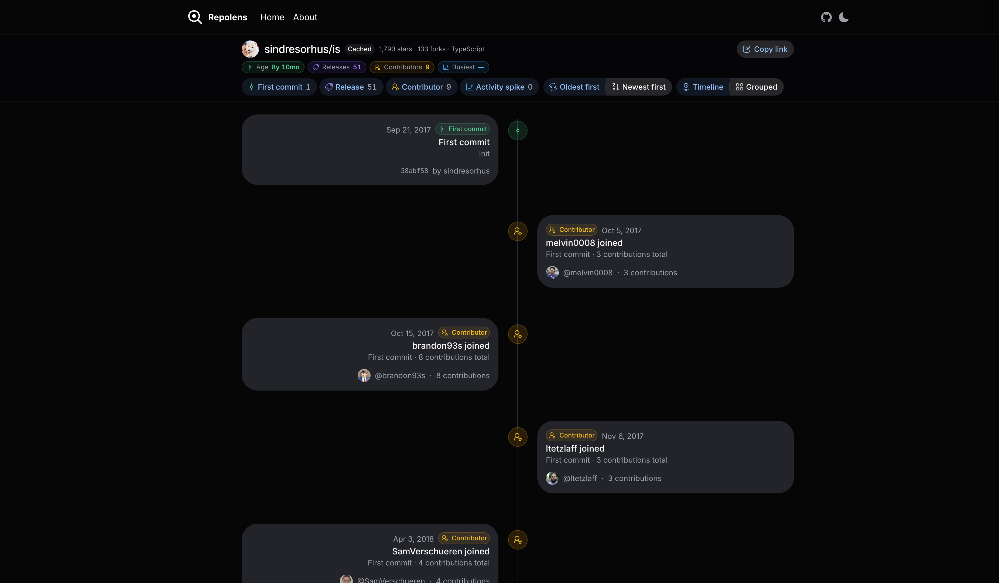

# Repolens

> Paste a public GitHub repo → get a scrollable, shareable timeline.

**Live at [repolens-ashy.vercel.app](https://repolens-ashy.vercel.app)**

[](LICENSE)



## What it is

Repolens turns any public GitHub repository into a visual timeline. v0.1 surfaces four event types:

1. **First commit**
2. **Releases** (capped at 100)
3. **Top-contributor first commits** (top 10 contributors)
4. **Monthly commit-activity spikes**

Results are cached in Supabase so repeat views stay fast and stay within GitHub rate limits. No accounts, no private repos — just a shareable URL per repo.

## Examples

- [vercel/next.js](https://repolens-ashy.vercel.app/vercel/next.js)
- [facebook/react](https://repolens-ashy.vercel.app/facebook/react)
- [home-assistant/core](https://repolens-ashy.vercel.app/home-assistant/core)

Paste a URL or `owner/repo` on the home page.

## Stack

- Next.js 16 (App Router) + TypeScript + Bun
- Tailwind CSS v4 + HeroUI v3
- Motion + Hugeicons
- Supabase Postgres
- Octokit (GitHub REST)
- tRPC v11 + superjson
- Upstash Redis
- Sentry

## Local development

```bash
bun install
cp .env.example .env.local
# Add GITHUB_TOKEN (strongly recommended)

# Local Supabase (Docker required)
bun run db:start
# After schema edits: bun run db:diff -- -f <name> && bun run db:reset

bun dev
```

For a deployed host you'll also want Supabase, Upstash Redis, and `NEXT_PUBLIC_SITE_URL` set to your stable origin. See `.env.example`.

### Timeline harness

```bash
bun run timeline vercel/next.js
```

## Project layout

| Path | Role |
| --- | --- |
| `lib/github.ts` | Octokit wrappers |
| `lib/repolens.ts` | `buildTimeline()` |
| `lib/cache.ts` | Supabase snapshot cache |
| `server/routers/` | tRPC routers |
| `supabase/schemas/` | Declarative DB schema (source of truth) |
| `scripts/timeline.ts` | CLI harness |
| `app/[owner]/[repo]/` | Timeline page + OG image |

## License

MIT
